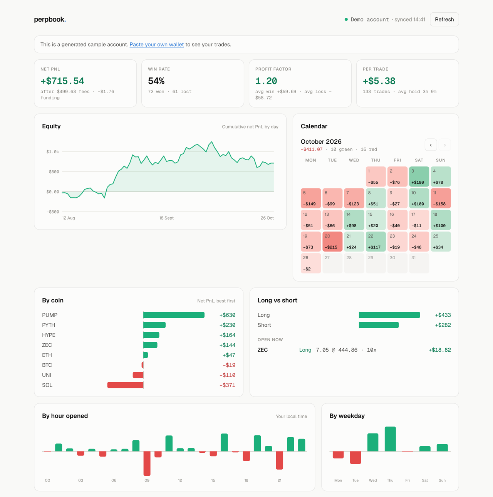

# perpbook

[](https://github.com/patrickballard/perpbook/actions/workflows/ci.yml)
[](LICENSE)

**The free, open-source trading journal and PnL tracker for Hyperliquid.** Paste a wallet address and get every trade rebuilt, your real PnL after fees and funding, and where your edge actually is. No API keys, no CSVs, no manual entry.

**[Try it on perpbook.vercel.app](https://perpbook.vercel.app)** · [Demo account](https://perpbook.vercel.app/w/demo) · [Self-host in one command](#self-hosting)

- **Trades, not fills.** Scale in three times and out twice and it's still one trade. Flips are split into a closed trade and a new one; fees and funding go to the right trade. On one active wallet, 7,800 fills became 773 trades; grouped naively they look like 3,244.
- **Real PnL you can check.** Net of fees and hourly funding, by day, coin, side, hour and weekday. Realised plus open PnL is compared with Hyperliquid's own all-time figure, and the dashboard says when they match.
- **Your own copy.** Hyperliquid's API only guarantees your latest 10,000 fills. Save a wallet and perpbook keeps a copy of every fill from then on, which also loads in seconds.
- **Read-only.** perpbook only reads public data for an address. It never asks for keys or signatures.
- **Yours.** AGPL-3.0. Self-host it for free, or use the hosted version.

<picture>
  <source media="(prefers-color-scheme: dark)" srcset="docs/dashboard-dark.png">
  
</picture>

Works for Hyperliquid perps, including front-ends built on it (such as Invo) and builder-deployed (HIP-3) markets.

## Try it

```bash
npm install
npm run dev
```

Open <http://localhost:3000> and paste an address, or go to `/w/demo` for a generated sample account.

## How it works

```
src/lib/hyperliquid/   client for the public info endpoint + normalisation (spot filtered out, de-duplicated)
src/lib/engine/        trades.ts  rebuilds round trips from fills
                       stats.ts   win rate, profit factor, expectancy, breakdowns, daily PnL, equity
src/lib/db/            Postgres schema, migrations and queries for stored history
src/lib/sync/          syncWallet, the Hyperliquid weight budget, and the API logic
src/worker/            the sync worker (`npm run worker`)
src/components/        dashboard, equity chart, PnL calendar, breakdown bars, trades table
```

**Trade reconstruction.** A trade opens when a coin's position leaves zero and closes when it returns to zero. Hyperliquid reports the position size before every fill (`startPosition`), which perpbook treats as the source of truth. That also catches gaps: if the reported size disagrees with what we've tracked, the trade is closed and flagged `partial` rather than silently producing wrong numbers.

**History and very active wallets.** Hyperliquid's API docs say only your most recent 10,000 fills are available. In practice (October 2026) older fills are still served, but perpbook doesn't rely on that: when it has a database, a wallet can be saved with "Save history", and a worker stores every new fill and funding payment, so the dashboard loads stored history plus anything newer from Hyperliquid. Some wallets are too active to rebuild in a browser (whales can have hundreds of thousands of fills). perpbook loads up to 20,000 fills from Hyperliquid, or 50,000 saved ones, and if a wallet has more it shows Hyperliquid's own totals rather than numbers rebuilt from part of its history. Saved wallets are capped at 50,000 stored fills (`MAX_FILLS_PER_WALLET`). Design notes: [docs/permanent-history.md](docs/permanent-history.md).

**League.** [/league](https://perpbook.vercel.app/league) ranks a week of Hyperliquid perps by % return: the week's perps PnL from Hyperliquid's own portfolio history (after fees and funding, open positions included) over the account at the start, or its weekly average if bigger. Unified accounts, whose margin sits in the spot balance, are measured against the whole account. The page refreshes at most every 10 minutes and keeps each entrant's result between refreshes, so a big league costs Hyperliquid one round of requests per 10 minutes, not one per visitor. Seasons and entrants live in `src/lib/league/seasons.ts`; `npm run league-final` freezes a finished week's table.

## Self-hosting

Without a database, perpbook runs entirely in the browser (`npm run dev` above). To keep history permanently:

```bash
docker compose up -d
```

That starts Postgres, the app on <http://localhost:3000> and the sync worker. For the free hosted setup (Vercel, Neon and a scheduled GitHub Actions job as the worker), see [docs/deploy.md](docs/deploy.md). To run them yourself instead, point `DATABASE_URL` at any Postgres and start both processes:

```bash
DATABASE_URL=postgres://… npm run migrate
DATABASE_URL=postgres://… npm start
DATABASE_URL=postgres://… npm run worker
```

| Variable | Default | |
|---|---|---|
| `DATABASE_URL` | unset | Postgres connection string. Unset turns storage off. |
| `HL_WEIGHT_PER_MINUTE` | `1000` | The worker's share of Hyperliquid's 1,200 per-IP budget. Run one worker per IP. |
| `TRACK_PER_IP_PER_DAY` | `3` | New wallets one visitor can save per day. |
| `CLIENT_IP_HEADER` | unset | The header your reverse proxy sets to the visitor's IP (e.g. `x-forwarded-for`, `cf-connecting-ip`), for the per-visitor limit. Not needed on Vercel. Unset elsewhere, all visitors share one daily allowance, since any visitor could fake an IP header. |
| `MAX_TRACKED_WALLETS` | `2000` | Stop accepting new wallets past this. |
| `MAX_FILLS_PER_WALLET` | `50000` | Stop saving a wallet's fills past this, so one whale can't fill a free database. |
| `STORAGE_LIMIT_MB` | `400` | Stop saving new wallets and fills once the database is this big (Neon's free tier is 0.5 GB). |
| `SITE_URL` | unset | Public URL, e.g. `https://perpbook.example`, so share images get absolute links. Not needed on Vercel. |

## Tests

```bash
npm test
```

The engine is covered for simple round trips, scaling in and out, flips, positions opened before the available history, missing fills, multi-coin accounts, funding attribution, spot filtering and the stats maths. Storage and sync tests run on [PGlite](https://pglite.dev) against a fake Hyperliquid, so they need no database server.

## Roadmap

- [x] Wallet sync, trade reconstruction, dashboard, PnL calendar, breakdowns
- [x] Postgres storage and a sync worker (permanent history past 10,000 fills)
- [x] Totals checked against Hyperliquid's own PnL; share cards for wallet links
- [ ] Accounts: sign in, follow several wallets
- [ ] Notes, setup tags and mistake tags on every trade; R multiples from a planned stop
- [ ] CSV import with a TradeZella preset
- [ ] One-command self-hosting with Docker Compose
- [ ] Hosted Pro plan: unlimited wallets, full history, breakdowns by setup, AI weekly review

## Contributing

Issues and pull requests are welcome; see [CONTRIBUTING.md](CONTRIBUTING.md). New venue adapters are the most useful contribution.

## Licence

[AGPL-3.0](LICENSE). You can use, modify and self-host perpbook freely. If you offer a modified version to others as a service, you must publish your changes under the same licence.

perpbook is an analytics tool, not financial advice.
